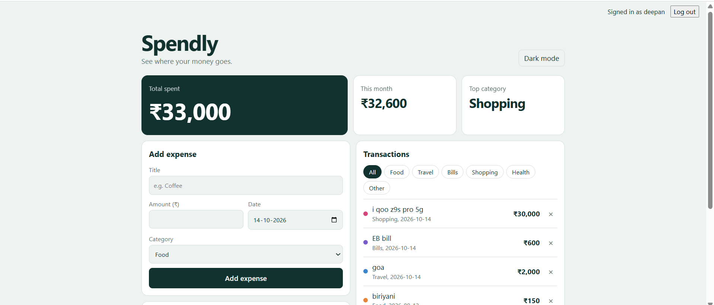
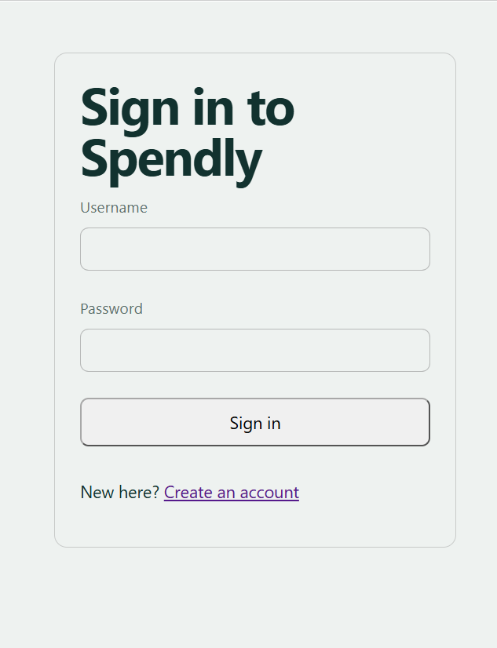
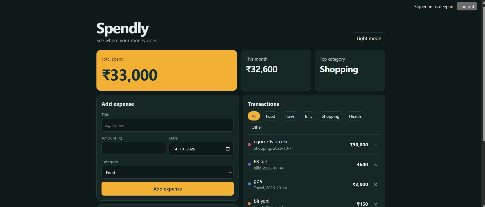
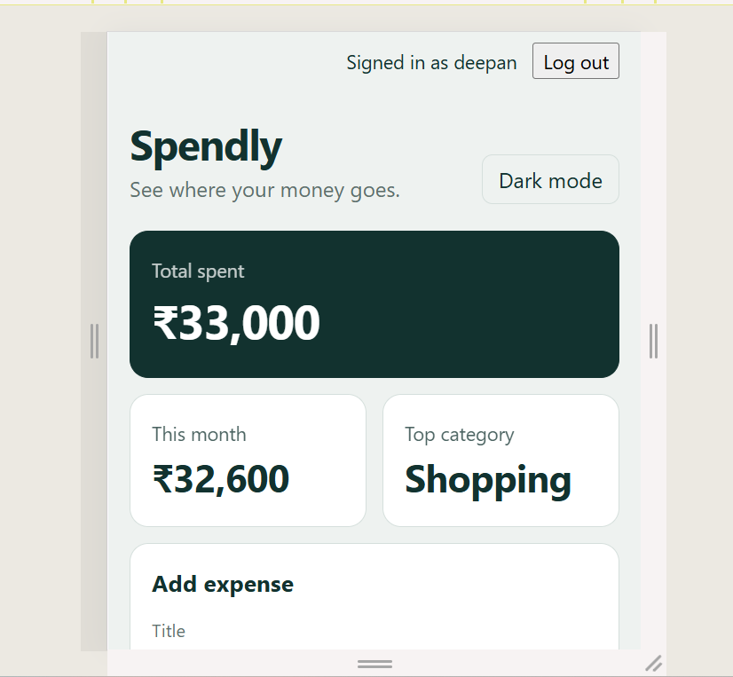
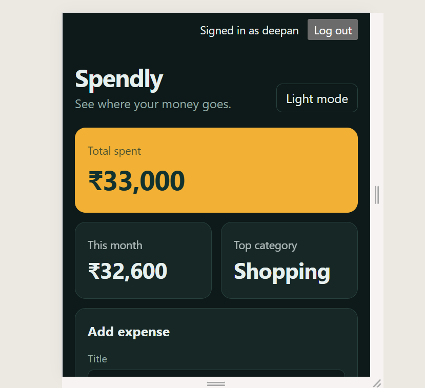

# Spendly: Full-Stack Expense Tracker

A responsive expense tracker that shows where your money goes. Users register, log in and manage their own expenses. Each user sees only their own data.

- **Live app:** https://spendly-expense-tracker-rust.vercel.app
- **Live API:** https://spendly-api-k5s5.onrender.com/api
- **Repo:** https://github.com/deepankumar0710/spendly-expense-tracker

> The backend runs on a free plan and sleeps when idle. The first request after a quiet period can take 30 to 60 seconds. Please wait and it will respond.



## Screenshots

| Login | Dashboard | Dark mode |
|---|---|---|
|  |  |  |

### Mobile

| Light | Dark |
|---|---|
|  |  |

## Features

- Register and log in with JWT authentication, with automatic token refresh
- Add expenses with title, amount, date and category, with input validation
- Delete expenses
- Summary cards: total spent, this month's spending and top category
- Bar chart of spending by category (click a bar to filter)
- Category filter chips on the transactions list
- Per-user data isolation: another user's expense returns 404
- Light and dark mode, remembering your choice
- Responsive layout for desktop and mobile
- Keyboard accessible, with visible focus and labels for screen readers
- 23 automated backend tests

## Tech stack

| Part | Technology |
|---|---|
| Frontend | React (hooks), JavaScript (ES6+), Vite, axios, react-router-dom, CSS (Grid, Flexbox, variables) |
| Backend | Python, Django 6.1, Django REST Framework, SimpleJWT, django-filter, django-cors-headers |
| Database | PostgreSQL in production, SQLite locally |
| Deployment | Vercel (frontend), Render (backend), hosted PostgreSQL |
| Other | gunicorn, whitenoise, python-decouple, dj-database-url, ESLint, Git and GitHub |

## API

Base URL: `/api`. All endpoints except register, login and refresh need the header `Authorization: Bearer <access token>`.

| Method | Endpoint | Description |
|---|---|---|
| POST | `/auth/register/` | Create an account (username, email, password, password2) |
| POST | `/auth/login/` | Get `access` (30 min) and `refresh` (7 days) tokens |
| POST | `/auth/token/refresh/` | Get a new access token |
| GET | `/auth/me/` | Current user |
| GET | `/expenses/` | List own expenses. Query: `category`, `month`, `year`, `search`, `ordering`, `page`, `page_size` |
| POST | `/expenses/` | Create an expense (title, amount, category, date, notes) |
| GET / PUT / PATCH / DELETE | `/expenses/<id>/` | Read, update or delete one expense |
| GET | `/summary/` | Total spent, this month, top category, category totals |

## Project structure

```
spendly/
  src/                      React app
    api/                    axios client, API calls, data mappers
    context/AuthContext.jsx login state
    components/             AddForm, Chart, List, Stats, ProtectedRoute
    pages/                  Login, Register
    constants.js            categories, colors, helpers
    App.jsx                 app state and layout
    Root.jsx                routes
    main.jsx                entry point
    index.css               styles and theme variables
  backend/                  Django API
    config/                 settings and urls
    accounts/               register, login, me
    expenses/               model, serializers, filters, views, tests
```

## Run locally

Requirements: Python 3.13, Node.js, Git.

**1. Clone**

```bash
git clone https://github.com/deepankumar0710/spendly-expense-tracker.git
cd spendly-expense-tracker
```

**2. Backend** (Windows PowerShell)

```powershell
cd backend
python -m venv venv
venv\Scripts\Activate.ps1
pip install -r requirements.txt
```

Create `backend/.env` with one line per setting:

```
SECRET_KEY=your-own-long-random-key
DEBUG=True
ALLOWED_HOSTS=localhost,127.0.0.1
CORS_ALLOWED_ORIGINS=http://localhost:5173
DATABASE_URL=sqlite:///db.sqlite3
```

Then:

```powershell
python manage.py migrate
python manage.py runserver
```

**3. Frontend** (second terminal, at the repo root)

Create `.env` with `VITE_API_URL=http://127.0.0.1:8000/api`, then:

```bash
npm install
npm run dev
```

Open http://localhost:5173.

**4. Tests**

```powershell
cd backend
python manage.py test
```

## Deployment notes

- Backend on Render with root directory `backend`. Build command: `pip install -r requirements.txt && python manage.py collectstatic --no-input && python manage.py migrate`. Start command: `gunicorn config.wsgi`. Migrations run on every deploy.
- Frontend on Vercel, with the environment variable `VITE_API_URL` pointing to the live API.
- Free tiers: the backend sleeps when idle, and free database plans have limits.

## Security notes

- Secrets live in environment variables and are never committed.
- The server sets the expense owner from the token, so a user cannot read or create another user's data.
- Tokens are stored in `localStorage` for simplicity. This is readable by XSS, and httpOnly cookies are the more secure choice for production.

## What I learned

- Splitting a UI into reusable components and passing data with props
- Lifting state up so sibling components share the same data
- Controlled form inputs and validation
- Building a REST API with Django REST Framework and JWT authentication
- Isolating each user's data on the server
- Connecting React to an API with axios, token refresh and loading and error states
- Writing automated API tests
- Deploying a full-stack app with environment variables, CORS and a PostgreSQL database

## Future improvements

- Edit existing expenses
- Monthly budget with warnings
- Export to CSV
- httpOnly cookie authentication
- Load summary totals from the `/summary/` endpoint for very large lists

## Author

Deepan Kumar S | deepanmessi0710@gmail.com